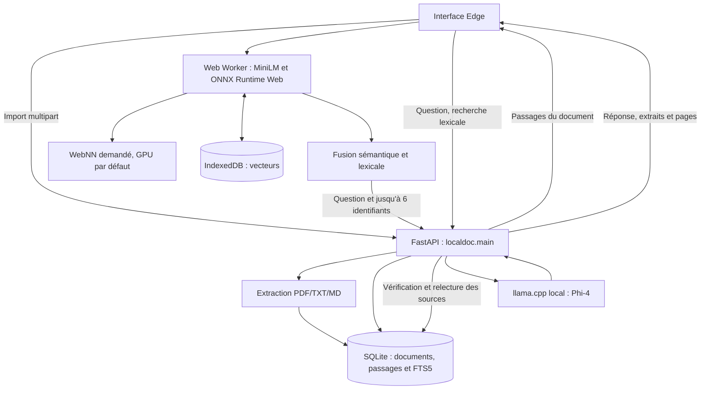

> Migration du 6 novembre 2026 : génération avec llama.cpp. Les mesures et captures antérieures restent des preuves historiques Ollama.

# LocalDoc AI — Documentation technique

**État décrit : 5 novembre 2026 — application 0.2.0**  
**Public :** développement, installation et maintenance.  
**Complément :** [documentation fonctionnelle](DOCUMENTATION_FONCTIONNELLE.md).

## 1. Périmètre

Le projet contient une seule application : **LocalDoc RAG WebNN**. Elle permet l'import de documents, la recherche de passages dans le navigateur et la génération de réponses sourcées avec Phi-4 dans llama.cpp.

Le serveur est `localdoc.main:app`, à l'adresse habituelle `http://127.0.0.1:8766`. Le dossier `web/` contient l'unique interface. Le port 8767 est réservé dans les procédures à une instance de test ou de développement du même serveur, avec un dossier de données distinct : ce n'est pas une seconde version du produit.

L'architecture est hybride. WebNN concerne les embeddings de recherche, pas la génération Phi-4. Le choix explicite WASM dans les options est un autre moteur d'exécution des mêmes embeddings, dans la même interface.

## 2. Architecture RAG



Le serveur ne fait pas confiance au texte d'un passage transmis par le navigateur : l'appel de génération contient les identifiants, et le texte est relu dans la base du document demandé. La page et le marqueur `[S1]` sont reconstruits côté serveur.

## 3. Organisation

| Fichier ou dossier | Rôle |
|---|---|
| [`localdoc/main.py`](localdoc/main.py) | Unique application FastAPI : documents, recherche lexicale, génération et fichiers statiques |
| [`localdoc/engine.py`](localdoc/engine.py) | Extraction, découpage, SQLite, FTS5, client llama.cpp et réponse sourcée |
| [`web/index.html`](web/index.html), [`web/style.css`](web/style.css) | Interface RAG |
| [`web/rag.js`](web/rag.js) | États de l'interface, appels API, progression et gestion du worker |
| [`web/rag-worker.js`](web/rag-worker.js) | Indexation, cache IndexedDB, similarité et fusion des classements |
| [`web/browser-encoder.js`](web/browser-encoder.js) | Tokenizer, fenêtres, session ONNX, pooling et normalisation |
| [`web/prepare.mjs`](web/prepare.mjs) | Téléchargement du modèle et copie du runtime local |
| [`web/launch.ps1`](web/launch.ps1) | Démarrage du serveur et du profil Edge |
| [`web/vite.config.js`](web/vite.config.js) | Compilation et proxy de développement |
| `web/public/model/`, `web/public/runtime/` | Modèle et runtime préparés, exclus du versionnement |
| `web/dist/` | Build de l'interface servi par FastAPI |
| `web/.edge-profile/` | Profil Edge dédié, avec son stockage navigateur |
| `web/.launcher/` | PID et journaux du serveur lancé en arrière-plan |
| `tests/` | Tests Python |
| `web/make-fixture.py`, `web/verify-rag.mjs` | Recette réelle avec PDF fictif, Edge, WebNN et Phi-4 |
| `web/test-results/`, `web/evidence/` | Données de recette et preuves locales de validation |
| `data/` | Documents opérationnels, SQLite et éventuels rapports locaux |

Les anciens écrans et scripts de diagnostic ne font plus partie de l'application. Des fichiers de résultats historiques peuvent encore se trouver dans les dossiers de preuves ; ils ne sont ni compilés ni exposés par l'interface.

## 4. Configuration et dépendances

### Environnement observé

Validation historique avant migration llama.cpp : Windows, Python 3.11.7, Node.js 24.18.1, Ollama 0.40.14, Edge 156, Intel Core i9-13980HX et RTX 4080 Laptop de 12 Go. Phi-4 a été vérifié chargé à `100% GPU` avec `ollama ps` après restauration des bibliothèques CUDA officielles de la version installée.

Ce relevé ne constitue pas une configuration minimale validée. Une exécution CPU reste possible avec des délais supérieurs. Vite 7 exige Node compatible, notamment 20.19+ ou 22.12+.

| Ensemble | Dépendances déclarées |
|---|---|
| Python applicatif | FastAPI `>=0.110,<1`, Uvicorn `>=0.30,<1`, python-multipart `>=0.0.9,<1`, pypdf `>=5,<8` |
| Python de test | pytest `>=8,<10`, httpx `>=0.28,<1`, reportlab `>=4,<6`, plus les dépendances applicatives |
| JavaScript applicatif | ONNX Runtime Web `1.31.1`, Hugging Face Tokenizers `0.2.0` |
| Développement JavaScript | Vite `^7.3.7`, Playwright Test `^1.64.1` |

Les dépendances JavaScript sont verrouillées par `web/package-lock.json` et installées par `npm ci`. Les dépendances Python utilisent des plages de versions ; il n'y a pas de verrou complet des versions transitives.

| Paramètre | Valeur |
|---|---|
| Dossier documentaire | `<racine>/data` ou `LOCALDOC_DATA_DIR` |
| Adresse llama.cpp | `http://127.0.0.1:8081` ou `LOCALDOC_LLAMA_URL` |
| Modèle de génération | `phi4` |
| Modèle de recherche | MiniLM L6 v2 ONNX, FP32, 384 dimensions |
| Révision MiniLM | `aff7a1dc4e8a1ea593e6ea21e95c22ef0a25966f` |
| Contexte Phi-4 | 4 096 tokens |
| Limite de sortie | 480 tokens |
| Température | 0 |
| Streaming | Désactivé |
| Conservation Phi-4 | Pendant la durée de vie de llama-server |

L’URL llama.cpp et le modèle Phi-4 sont dans `engine.py`. Elles ne sont pas lues automatiquement depuis un `.env`. Définir `LOCALDOC_DATA_DIR` avant le démarrage du serveur ; les chemins sont calculés à l'import du module.

## 5. Installation sous Windows

Installer Python, Node.js et Microsoft Edge. Le script installe llama.cpp/CUDA 12.4 pour Windows x64/NVIDIA. Depuis la racine :

```powershell
.\installer-webnn.bat
```

Le script d'installation :

1. Crée `.venv` si nécessaire.
2. Installe `requirements.txt` avec le Python de `.venv`.
3. Exécute `npm ci` dans `web/`.
4. Lance `node prepare.mjs`.
5. Compile l'interface avec `npm run build`.

Le script installe llama.cpp b12110 et ses bibliothèques CUDA officielles, vérifie les empreintes SHA-256 des archives et réutilise le GGUF Phi-4 présent dans le stockage Ollama via un lien NTFS (copie si nécessaire). Sans modèle existant, placer Phi-4 dans `models/phi4.gguf`. Le lancement ne dépend plus du service Ollama. Voir le README pour les variables de configuration.

`prepare.mjs` récupère `model.onnx`, `model.onnx_data`, `tokenizer.json` et `tokenizer_config.json` à la révision figée du dépôt `onnx-community/all-MiniLM-L6-v2-ONNX`, pour environ 91 Mo de modèle. Il copie les fichiers WASM/JSEP du paquet npm dans `public/runtime/` et écrit `provenance.json`.

Les téléchargements utilisent un fichier `.part` renommé après réussite. Un fichier cible déjà présent est ignoré : son empreinte n'est pas vérifiée automatiquement. En cas de corruption, remplacer le fichier concerné avant de refaire la préparation.

## 6. Lancement, arrêt et développement

### Lancement utilisateur

```powershell
.\demarrer-webnn.bat
```

`web/launch.ps1` vérifie le build et le port 8766, démarre le serveur Python si nécessaire, contrôle `/api/health` puis ouvre Edge avec :

- `--enable-features=WebMachineLearningNeuralNetwork` ;
- un `--user-data-dir` pointant vers `web/.edge-profile/` ;
- l'adresse `http://127.0.0.1:8766`.

La fermeture d'Edge n'arrête pas le serveur en arrière-plan. Le lanceur peut réutiliser un serveur déjà présent ; il ne redémarre pas automatiquement un backend après modification de son code.

### Lancement manuel

```powershell
.\.venv\Scripts\python.exe -m uvicorn localdoc.main:app --host 127.0.0.1 --port 8766
```

Arrêt avec `Ctrl+C` dans ce terminal. Pour le serveur en arrière-plan, lire le PID puis vérifier la ligne de commande avant tout arrêt :

```powershell
$serverProcessId = [int](Get-Content 'web\.launcher\server.pid')
Get-CimInstance Win32_Process -Filter "ProcessId = $serverProcessId" |
  Select-Object ProcessId, CommandLine
```

Un PID peut être réutilisé par Windows. Après vérification du serveur concerné, l'arrêter avec le Gestionnaire des tâches ou `Stop-Process -Id $serverProcessId`.

### Développement frontend

```powershell
# Terminal 1, racine : API du même produit sur le port du proxy
.\.venv\Scripts\python.exe -m uvicorn localdoc.main:app --host 127.0.0.1 --port 8767

# Terminal 2
cd web
npm run dev
```

Vite écoute sur 8766 et relaie `/api` vers 8767. Le port 8766 doit être libre. L'activation de WebNN reste une propriété du navigateur utilisé.

Pour reconstruire :

```powershell
cd web
npm run build
```

Le build doit exister avant le démarrage initial du serveur pour que son montage statique soit activé. Après modification Python, redémarrer le serveur ; après modification frontend, recompiler puis actualiser. Aucun serveur autonome de fichiers ne remplace l'API RAG.

## 7. Données et compatibilité

Par défaut :

```text
data/
├── localdoc.sqlite3
├── uploads/
│   └── <UUID du document>.<extension>
└── webnn-performance.json       # éventuel relevé local historique
```

| Table | Contenu |
|---|---|
| `documents` | Identifiant, nom, titre, auteur et origine de l'auteur, pages, date UTC, SHA-256, extension, nombre de passages et pages sans texte |
| `chunks` | Identifiant entier, document, page et contenu |
| `chunks_fts` | FTS5 : document non indexé, contenu indexé ; rowid aligné avec l'identifiant du passage |

La colonne historique `chunks.embedding` est conservée dans le schéma existant pour éviter une migration destructive des bases. Aucun code applicatif ne calcule ni ne consulte ces anciennes valeurs. Les embeddings actifs sont ceux de MiniLM dans le navigateur.

FTS5 utilise `unicode61 remove_diacritics 2`. Chaque connexion active les clés étrangères et un `busy_timeout` de 5 000 ms. Le code synchronise manuellement FTS lors de l'import et de la suppression. Il n'y a pas de migrations versionnées ni d'index vectoriel ANN.

### Cache navigateur

- IndexedDB : `localdoc-webnn-vectors`, version 1.
- Object store : `indexes`.
- Clé : `MODEL_KEY + ':' + SHA-256 du fichier`.
- Valeur : identifiants de passages et vecteurs des fenêtres.

La clé contient la révision MiniLM et la stratégie de fenêtres, mais pas le périphérique demandé. Le worker contrôle les identifiants, le nombre des passages, les dimensions et la finitude des vecteurs relus. CPU/GPU/WASM utilisent le même modèle, donc un index peut être réutilisé entre ces moteurs.

Le cache dépend du profil et de l'origine, port compris. Le déplacement du profil du projet vers `web/.edge-profile/` conserve ses données pour l'origine 8766. L'instance de recette 8767 utilise une origine distincte.

La suppression serveur ne purge pas automatiquement IndexedDB, les captures ou les rapports locaux. Pour une sauvegarde documentaire cohérente, arrêter les serveurs concernés et copier SQLite avec l'intégralité de `uploads/`. Les vecteurs navigateur sont recalculables.

## 8. Pipeline d'import

1. Lire au maximum 25 Mio plus un octet pour détecter un dépassement.
2. Accepter `.pdf`, `.txt`, `.md` ; vérifier également l'en-tête `%PDF-` pour le PDF.
3. Extraire via pypdf : au plus 600 pages, PDF chiffrés refusés. TXT/MD sont décodés en UTF-8 avec remplacement des caractères invalides.
4. Extraire les métadonnées et, à défaut d'auteur, chercher une mention explicite dans les trois premières pages.
5. Découper par page avec une limite de 950 caractères et un chevauchement visé de 130 caractères. Les frontières privilégient ponctuation ou espace ; les passages de 10 caractères ou moins sont ignorés.
6. Dédupliquer sur SHA-256 des octets, indépendamment du nom.
7. Enregistrer le document, les passages, FTS et le fichier original nommé par UUID.

Chaque passage reste rattaché à sa page. TXT/MD utilisent la page logique 1. Les pages sans texte sont comptées ; aucun OCR n'est déclenché. Un document sans passage exploitable est rejeté.

## 9. Recherche sémantique et lexicale

Le navigateur reçoit tous les passages du document choisi. Le worker initialise le tokenizer et une session ONNX Runtime avec `webnn` demandé et préférence GPU par défaut. Les options permettent aussi WebNN CPU/NPU ou WASM explicite. L'absence de l'API WebNN provoque une erreur lisible, sans bascule automatique vers le choix WASM de l'interface.

Chaque passage est couvert par fenêtres de 126 tokens de contenu, pas de 96 tokens, avec les tokens spéciaux portant l'entrée à 128 positions. L'entrée est paddée avec masque ; batch 1, tenseurs int64, sortie attendue `[1,128,384]`. Toutes les fenêtres, y compris la fin du passage, sont encodées. Un pooling moyen masqué puis une normalisation L2 produisent les vecteurs.

Les vecteurs sont conservés en mémoire et dans IndexedDB si possible. Le calcul se déroule dans un Web Worker ; le runtime WASM est configuré sur un thread, avec proxy désactivé. ONNX Runtime peut répartir des opérations entre WebNN et du calcul CPU : demander un GPU ou NPU ne prouve pas l'identité du périphérique utilisé.

Pour la question, la même stratégie de fenêtres est utilisée. Le score sémantique d'un passage est le maximum des produits scalaires entre ses fenêtres et celles de la question. Avec la normalisation L2, il correspond à une similarité cosinus.

La recherche lexicale serveur conserve jusqu'à 12 mots de plus de deux caractères après retrait de mots fréquents, puis produit une requête FTS en `OR`. Elle renvoie jusqu'à 35 passages classés par FTS5.

Le worker fusionne les 35 premiers résultats sémantiques et lexicaux par RRF : addition de `1/(61+rang)` pour chaque liste, rang à partir de zéro. Jusqu'à six passages sont retenus pour Phi-4.

Il n'y a pas de reranker ni de seuil d'abstention sémantique calibré. Un document indexé peut fournir des passages même si l'information demandée est absente. La consigne d'abstention au modèle n'est donc pas une garantie de détection des questions sans réponse.

## 10. Génération et API

Le corps de génération impose une question de 3 à 1 000 caractères et une liste de 1 à 6 identifiants. Le serveur déduplique les identifiants en préservant leur ordre, puis vérifie qu'ils appartiennent au document demandé. Une source étrangère est rejetée avant tout appel llama.cpp.

Le contexte est composé des marqueurs `[S1]`, des pages et du texte relu en base. Phi-4 reçoit une consigne de réponse en français à partir des seuls extraits, de citations et de brièveté. L'appel local `/v1/chat/completions` utilise `stream: false`, température 0 et `max_tokens: 480`. Le lanceur configure le contexte à 4096 et un seul slot. La réponse est lue dans `choices[0].message.content`, les jetons dans `usage` et les durées disponibles dans `timings` (millisecondes). Les durées absentes restent nulles. Le délai réseau est de 240 secondes.

| Méthode | Route | Résultat |
|---|---|---|
| `GET` | `/api/health` | Configuration et identifiant `localdoc-rag-webnn` |
| `GET` | `/api/documents` | Liste des documents |
| `POST` | `/api/documents` | Multipart `file`, retourne `document` et `duplicate` |
| `GET` | `/api/documents/{doc_id}/original` | Original affiché inline |
| `DELETE` | `/api/documents/{doc_id}` | Suppression de l'original et de ses enregistrements |
| `GET` | `/api/webnn/documents/{doc_id}/chunks` | Document et passages `{id,page,content}` |
| `POST` | `/api/webnn/documents/{doc_id}/lexical` | `question`, retourne jusqu'à 35 passages lexicaux |
| `POST` | `/api/webnn/documents/{doc_id}/generate` | `question` et `chunk_ids`, retourne la réponse RAG |
| `GET` | `/` | Interface compilée |

Exemple d'entrée de génération, avec des identifiants réels à substituer :

```json
{"question":"Quel est le budget ?","chunk_ids":[123,124]}
```

La réponse contient `answer`, `sources`, `mode: rag-webnn-phi4`, `warning`, `elapsed_seconds` et `generation_stats`. Ce dernier détaille `load_seconds`, `prompt_seconds`, `generation_seconds`, `prompt_tokens` et `output_tokens`. Les durées disponibles proviennent de `timings` llama.cpp, converties de millisecondes en secondes ; les durées absentes et le chargement sont nulls. L'interface affiche le total de recherche et le total de réponse.

Le contrôle de citation repère les marqueurs isolés avec `\[(S\d+)\]`. Il ne vérifie pas toutes les citations groupées, chaque affirmation ni la correspondance sémantique avec la source. Une réponse vide conserve les sources et affiche un message explicatif ; une sortie partielle non vide peut atteindre la limite de tokens sans avertissement spécifique.

Erreurs : `400` pour import invalide ou source étrangère, `404` pour document absent, `422` pour corps non conforme ou certaines erreurs d'extraction, `503` pour erreur llama.cpp. Le lanceur signale un moteur ou un modèle absent. Les erreurs worker sont affichées côté interface. Le statut health ne réalise pas une inférence de contrôle.

## 11. Tests

```powershell
.\.venv\Scripts\python.exe -m pip install -r requirements-dev.txt
.\.venv\Scripts\python.exe -m pytest -q tests
```

Après nettoyage, le périmètre WebNN comprend 12 tests Python : extraction et métadonnées, import/déduplication, classement lexical, suppression, appel Phi-4 et citations, réponse vide, erreurs HTTP et connexion llama.cpp, PDF de plusieurs pages, isolation des sources entre documents et absence des anciennes routes. Les appels llama.cpp unitaires sont simulés. Un avertissement Starlette/TestClient lié à httpx reste visible dans l'environnement testé.

### Recette réelle Edge + WebNN + Phi-4

Premier terminal à la racine :

```powershell
$env:LOCALDOC_DATA_DIR = Join-Path (Get-Location) 'web\test-results\rag-data'
.\.venv\Scripts\python.exe -m uvicorn localdoc.main:app --host 127.0.0.1 --port 8767
```

Second terminal à la racine :

```powershell
.\.venv\Scripts\python.exe web\make-fixture.py
cd web
npm run test:rag
```

Le test utilise un PDF entièrement fictif de trois pages. Il contrôle un montant attendu, une citation de page 2, la réutilisation du cache après rechargement, l'absence d'erreur JavaScript et de requête extérieure du navigateur, puis le débordement horizontal mobile. Les résultats sont réécrits dans `web/evidence/rag-webnn-llamacpp.json` et sa capture associée. Vérifier la date du rapport avant de le citer.

Les tests unitaires ne prouvent pas le fonctionnement d'un périphérique réel. Le test navigateur avec un moteur réel ne constitue pas à lui seul une validation métier sur les documents de l'utilisateur.

## 12. Performances et maintenance

Contrôles :

```powershell
Invoke-RestMethod 'http://127.0.0.1:8766/api/health'
Invoke-RestMethod 'http://127.0.0.1:8081/health'
Invoke-RestMethod 'http://127.0.0.1:8081/v1/models'
nvidia-smi
```

Les journaux `web/.launcher/llama-error.log` indiquent le périphérique CUDA et les couches déportées. Vérifier aussi `nvidia-smi` ; la présence du GPU seule ne prouve pas son utilisation.

Historique avant migration : le relevé local conservé dans `data/webnn-performance.json` décrit l'optimisation Phi-4 du 5 novembre 2026 : 50,348 s sur CPU, 15,387 s au premier appel GPU (dont 7,113 s de chargement), puis 2,253 s pour une répétition identique profitant du cache de contexte. Les deux appels GPU comptaient 1349 tokens de contexte ; leurs sorties étaient différentes en longueur. Le classement des sources pouvait différer de l'essai CPU. Ne pas généraliser ces valeurs à toutes les questions ou machines.

Trois mécanismes distincts influencent les temps : cache IndexedDB des vecteurs, modèle Phi-4 chargé, cache de contexte llama.cpp.

| Journal | Emplacement |
|---|---|
| Serveur en arrière-plan | `web/.launcher/server.log`, `server-error.log` |
| PID | `web/.launcher/server.pid` |
| Serveur au premier plan | Terminal de lancement |
| llama.cpp | `web/.launcher/llama.log`, `llama-error.log`, `llama.pid` |
| Recette navigateur | `web/evidence/` |

Une mise à jour du modèle ou des fenêtres doit faire évoluer `MODEL_KEY` et prévoir la reconstruction des index. Le profil Edge transféré conserve l'origine de production, le port et la clé du modèle ; aucun recalcul systématique n'est imposé par le seul déplacement de dossier.

## 13. Sécurité et limites

Le serveur est limité à la boucle locale par les lanceurs. Il n'y a pas d'authentification, de contrôle d'accès utilisateur, de chiffrement applicatif au repos ni de cloisonnement multi-utilisateur. Originaux, texte extrait, vecteurs et rapports peuvent contenir des données sensibles.

Le frontend utilise `textContent` pour les textes documentaires ; le serveur vérifie les sources relues. Ces mesures ne constituent pas une protection complète contre les instructions malveillantes présentes dans les documents. Le trafic observé dans une recette navigateur ne représente pas une analyse de tout le trafic système, d'Edge ou de llama.cpp.

Limites principales :

- Un document par question ; pas de mémoire de conversation ou d'historique durable.
- Pas d'OCR, d'analyse des images, d'extraction fiable des tableaux complexes ou de résumé exhaustif hiérarchique.
- MiniLM principalement anglophone ; pertinence française à évaluer sur un corpus métier.
- Pas de reranking, de seuil d'abstention calibré ou de validation des affirmations.
- Parcours des vecteurs en mémoire, sans index ANN ; coût croissant avec le document.
- Indexation séquentielle ; délai worker de 600000 ms, sans bouton d'annulation dédié.
- Réponse complète après génération, sans streaming.
- Périphérique WebNN réel non identifié ; combinaison avec du calcul CPU possible.
- Cache navigateur non purgé automatiquement à la suppression d'un document.
- Pas de migration de schéma versionnée ni de contrôle d'empreinte intégré au téléchargement du modèle.

## 14. Sources et licences

Les références principales sont le code, les tests et les rapports datés du projet. Pour les composants externes, dont la compatibilité peut évoluer :

- [ONNX Runtime WebNN](https://onnxruntime.ai/docs/tutorials/web/ep-webnn.html).
- [Spécification WebNN](https://webmachinelearning.github.io/webnn/).
- [llama.cpp : serveur et options](https://github.com/ggml-org/llama.cpp/blob/master/tools/server/README.md).
- [MiniLM à la révision retenue](https://huggingface.co/onnx-community/all-MiniLM-L6-v2-ONNX/tree/aff7a1dc4e8a1ea593e6ea21e95c22ef0a25966f).

ONNX Runtime est sous licence MIT ; MiniLM retenu et Tokenizers.js sont déclarés sous Apache-2.0 dans les références du projet. Les autres composants conservent leurs licences. Le fichier `LICENSE.txt` demande leur vérification avant distribution ou déploiement en entreprise.

## Validation llama.cpp du 6 novembre 2026

- Moteur officiel b12110, CUDA 12.4 ; archives vérifiées par SHA-256.
- Phi-4 GGUF existant réutilisé dans `models/phi4.gguf` par lien NTFS.
- 12 tests Python réussis et compilation Vite réussie.
- Parcours réel Edge/WebNN + llama.cpp : PDF fictif importé, montant de 48 275 euros correctement répondu avec source page 2 ; aucune erreur JavaScript ni requête externe du navigateur ; cache réutilisé après rechargement et largeur mobile vérifiée.
- Sur cet essai : recherche 4,1 s et génération/appel serveur 1,023 s (311 jetons en entrée, 35 en sortie). Ce document court ne constitue pas un benchmark comparatif.
- Le processus `runtime/llamacpp/llama-server.exe` est visible dans `nvidia-smi` ; mémoire GPU totale observée après chargement : 9 680 Mio (inclut les autres processus).
- Rapport et capture : `web/evidence/rag-webnn-llamacpp.json` et `.png`.
- Lanceur réel vérifié : `/api/health` expose `generation: llamacpp-local` sur le port 8766. Les documents de l’utilisateur sont conservés ; le test utilise une base isolée.
